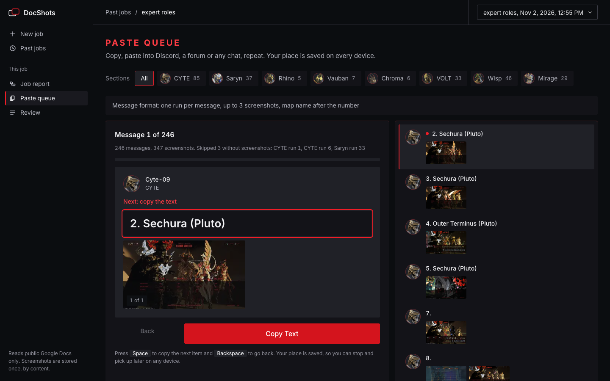
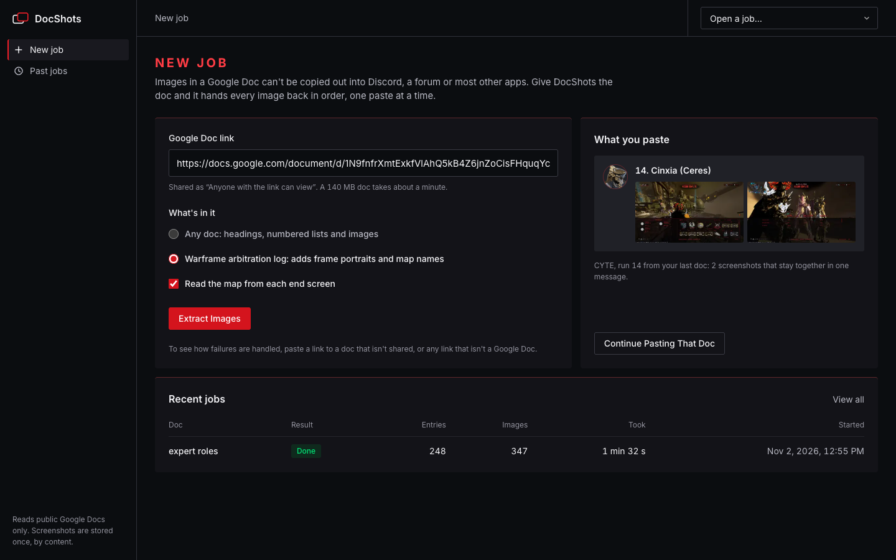
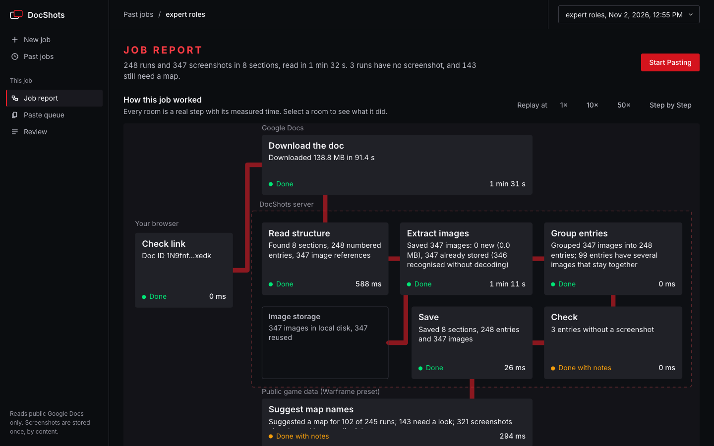
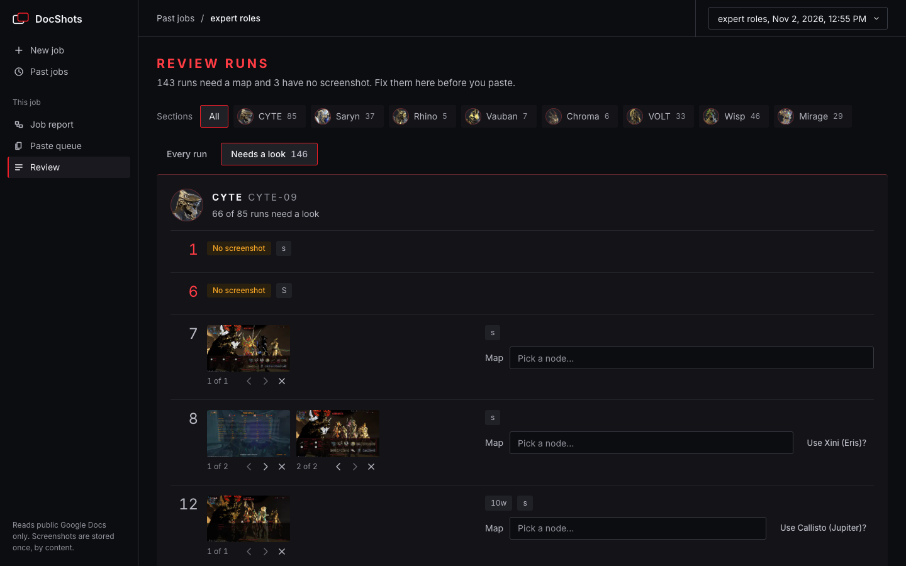

# DocShots

**Get every image out of a Google Doc, in order, and paste it anywhere: Discord, a forum, any chat.**

Google Docs won't let you copy images out into most apps. Give DocShots a doc's link and it hands every image
back in order, one paste at a time, with each entry's images kept together.



Built for Replit's internship challenge, *Build an App that Shows Its Work*: every job is drawn live as a
floor plan of its steps, with real timings, and can be replayed.

---

## Why I built it

I log runs from a game in a Google Doc: a heading per character, a numbered list underneath, and one to three
screenshots per entry. The community I submit to only accepts images posted directly, numbered.

Moving **347 screenshots** by hand meant saving each one, renaming it, and keeping every entry's images
together. DocShots now does it from the doc's link.

It isn't only for games. Any doc made of **headings, numbered lists and images** works: a trip log, a recipe
collection, a bug report with screenshots.

---

## What it looks like

The screenshots below are DocShots running on my own log: 248 Warframe arbitration runs and 347 screenshots,
with a section per character. In the game, an *arbitration* is a long survival mission, and each "run" in the
list is one completed mission with its end-of-mission screenshots.

### 1. Start a job

Paste a public Google Doc link. Pick "Any doc", or the Warframe preset for game logs. The panel on the right
shows a real message from your last job.



### 2. Watch it work

Each step is a room on a floor plan. The dashed wall is the server; Google Docs and your browser sit outside
it. Rooms light up as their events arrive, with what they did and how long it took. A failed step turns red
and says what to do next.



Replay any job at 1×, 10×, 50× or one event at a time. Select a room to see its log and the data it produced.

### 3. Paste

The paste queue builds one message at a time: the text line, then each image. Press **Space** to copy the next
piece, paste it where you're posting, repeat. Your place is saved, so you can stop at message 50 and pick up at
51 on another device.

### 4. Fix what needs a look

The review screen opens on the entries that need attention: no image, a duplicate, an image missing from the
export.



---

## How a job works

| Step | Where it runs | What it does |
| --- | --- | --- |
| **Check link** | Browser → server | Reads the doc ID from any Docs link. The link is saved before anything can fail. |
| **Download the doc** | Google Docs | Streams the doc's Markdown export, gzip-compressed. |
| **Read structure** | Server | Headings become sections, numbered lines become entries. Runs while the download continues. |
| **Extract images** | Server → storage | Decodes four images at once. Images from earlier jobs are recognised without decoding. |
| **Group entries** | Server | Puts every image under its section and entry, in document order. |
| **Check** | Server | Flags entries with no image, duplicate images and missing images. |
| **Save** | Postgres | Writes sections, entries and images in a few batched inserts. |
| **Suggest map names** | Public game data | Warframe preset only: reads the map name on each end screen. |

Every step sends start, progress, done, warning, failure and retry events. They stream to the page over
server-sent events and are stored, so a replay shows exactly what happened. Nothing is slowed down to make it
watchable.

---

## When things go wrong

| What happens | What DocShots does |
| --- | --- |
| The doc isn't shared, or the link is wrong | Stops at the download step and says how to share it. The link stays saved; **Try Again** reruns it. |
| The network drops or Google stalls for 60 s | Retries twice with backoff. Each retry shows on the diagram. Images already saved are kept. |
| The download is cut off part-way | Detected (every image in the export ends with `>`), then retried. |
| An image is missing or won't decode | Flagged on its entry. The rest of the job carries on. |
| Public game data is unavailable | Map suggestions are skipped with a note. Everything else finishes. |
| Too many jobs at once | Two running and twenty an hour per browser, with a message saying what to do. |

**Try it:** paste a link to a doc that isn't shared, or any link that isn't a Google Doc.

---

## Speed, measured on a real doc

My own log: **248 entries, 347 screenshots, 139 MB** of Markdown (110 MB gzipped on the wire).

| | First job | Same doc again |
| --- | --- | --- |
| Download | 70 s | 72 s |
| Images decoded | 347 | **2** (337 recognised without decoding) |
| Map suggestions | 13.1 s | **0.5 s** |

The download is the floor. Google takes about 36 s to prepare an export this size, then sends it at about
2.7 MB/s, and parsing keeps pace with it. Memory stays at about four images however big the doc is.

The zip, Word and HTML exports fail on a doc this size (HTTP 413 or a timeout), which is why DocShots streams
the Markdown export.

---

## Privacy and safety

- **Your jobs are yours.** Each browser gets an anonymous id, and jobs, images and progress are only visible to
  the browser that started them.
- **No requests to private networks.** Image links inside a doc are fetched only over https from public hosts.
- **Nothing kept forever.** Jobs older than 30 days are deleted, along with images no job uses.
- **Webhooks stay in your tab.** A Discord webhook address, if you use one, is never stored.

---

## Run it

```bash
npm install
npm run build
npm start      # http://localhost:3000
```

```bash
npm test       # parser, matching and link tests
```

Locally it needs nothing else: without `DATABASE_URL` it uses an embedded PGlite database, and without Object
Storage it keeps images on disk, both in `data/`.

### On Replit

1. Add a **PostgreSQL** database.
2. Add **App Storage**, so images survive redeploys.
3. Publish as a **Reserved VM**. Jobs keep running after the request that started them, which Autoscale would
   pause.

The sample doc link is set in `.replit` as `SAMPLE_DOC_URL`.

---

## Built with

React and Vite · Node and Express · Postgres (PGlite locally) · sharp · tesseract.js · server-sent events

## What I wrote, and what AI wrote

I chose the task, designed the product, supplied the real doc and checked every result against it. The code
was written with Claude (Anthropic) as a pair programmer, following my direction. The Markdown-export approach,
the streaming parser, the map reader and the interface were each tested on my real doc before being kept.

Sample doc photos: Wikimedia Commons (CC0 and public domain), credited in the doc itself.
